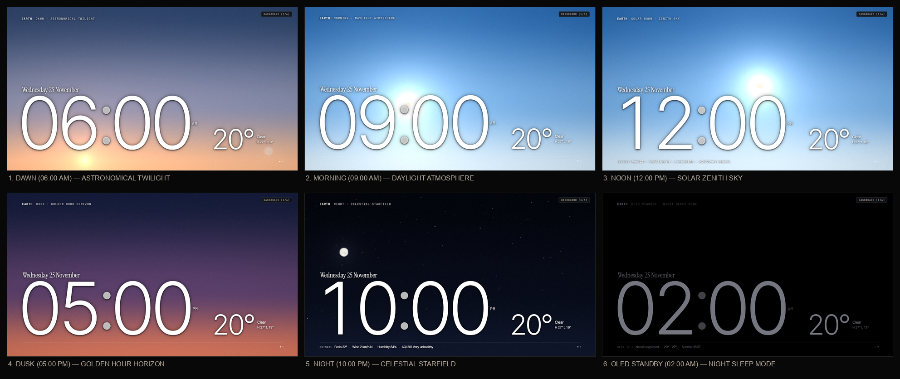

# Dwell — Headless Desk Dock

<div align="center">

<h1>Dwell</h1>
<p><strong>Display Well</strong></p>

[](https://github.com/str-VaibhavThakkar/dwell/actions)
[](LICENSE)
[](https://developer.android.com)
[](https://github.com/str-VaibhavThakkar/dwell/releases)
[-orange)](#edition-overview-dedicated-headless-desk-dock)
[-red.svg)](#prerequisites-and-installation)

</div>

---

> **Looking for the Universal Daily Driver edition?**  
> If you want to use Dwell on your everyday phone without root, read the **[Universal Launcher Manual](README.universal.md)** or switch to the [`oss/universal`](https://github.com/str-VaibhavThakkar/dwell/tree/oss/universal) branch.

---

## Edition Overview: Dedicated Headless Desk Dock

**Dwell (Headless Edition)** rescues old, discarded Android phones with **shattered screens, dead touch digitizers, or non-functional displays** and converts them into permanent 24/7 dedicated ambient desk clocks, astronomical workstations, and focus companions.

You do **not** need a functioning touchscreen to configure or operate Dwell:
- **100% Button-Operated**: Physical volume keys cycle pages, activate alarms, and start timers with zero screen touches.
- **Air Wave Sleep/Wake**: The phone's infrared proximity sensor detects hand waves to sleep or wake the display touchlessly.
- **24/7 Plugged-In Battery Guard**: Directly switches Linux kernel battery sysfs nodes (`/sys/class/power_supply/battery/`) to halt charging at 80% and resume at 60%, preventing battery swelling.
- **LAN PC Control Hub**: Embedded web server on port 8000 provides remote control, real-time hardware telemetry, live camera mirror, and task syncing directly from your desktop browser.
- **Hybrid Mode Support**: Have a working touchscreen and want the root battery guard? Simply turn off Kiosk Lock and Key Remapping in settings to use full touch.

---

## Visual Gallery

Dwell features dynamic Canvas 2D and WebGL procedural shaders that adapt to the real position of the sun, local weather, and celestial moon — all rendered on a pure AMOLED `#000000` canvas to eliminate night glare and backlight fatigue.

### 24-Hour Time Cycle: Dawn to OLED Night Mode
<div align="center">
  
  <p><em>Variation across natural hours (06:00 AM Dawn, 09:00 AM Morning, 12:00 PM Solar Noon, 05:00 PM Golden Hour Dusk, 10:00 PM Celestial Starfield, and 02:00 AM OLED Standby Sleep Mode).</em></p>
</div>

### Ambient Art Themes
<div align="center">
  
  <p><em>Hand-drawn Canvas 2D scenes layered over the sky engine: Desk Setup, Layered Mountains, Sakura Petals, Living Sky Shaders, OLED Deep Standby, and Celestial Starfield.</em></p>
</div>

### Procedural Weather Dynamics
<div align="center">
  
  <p><em>Real-time simulation of atmospheric conditions: high-visibility clear sky, golden hour, overcast rain streaks, and winter snowfall.</em></p>
</div>

### Workstation Suite and PC Control Hub
<div align="center">
  
  <p><em>Full productivity workstation: Astronomical Alarms, Pomodoro Focus Timer, Study Tasks, and Desktop PC LAN Web Hub.</em></p>
</div>

---

## Architecture and Features

### 1. In-Process Hardware Key Repurposing
Physical volume key events (`KEYCODE_VOLUME_UP`, `KEYCODE_VOLUME_DOWN`) are intercepted directly inside `MainActivity.dispatchKeyEvent` and fully consumed.
- **No System Volume Slider**: The Android system volume HUD is 100% suppressed.
- **Acoustic Feedback**: Taps and long presses trigger native chimes via `ToneGenerator`.
- **Contact Debounce and Lockout**: 15ms electrical contact debounce with a 650ms trailing tap lockout on long-press release prevents accidental duplicate inputs.

### 2. Battery Protection Daemon (24/7 Safe Charging)
Operating a phone on AC power 24/7 damages lithium-ion cells. Dwell uses root access to cycle charging switches:
- Cuts off charging at **80% capacity** via kernel sysfs switches (`charging_enabled = 0` / `battery_charging_enabled = 0` / `input_suspend = 1`).
- Automatically resumes charging at **60% capacity**, maintaining a perpetual safe float buffer.
- Tracks battery temperature every 30 seconds; if pack thermals exceed 42°C, charging halts unconditionally until cooled.

### 3. Air Wave Touchless Sleep/Wake
A proximity gesture engine queries the hardware infrared sensor (`Sensor.TYPE_PROXIMITY`):
- **Wave to Sleep**: Hovering your hand over the top bezel puts the screen to sleep instantly.
- **Sleep Immunity**: Spurious wakes are blocked while the display is asleep; waking requires a hardware button press or deliberate sensor wave.
- **Unconditional Reset to Clock**: Waking the device always resets the view to Page 0 (Clock & Weather), ensuring the device is always an immediate timepiece.

### 4. Hybrid Mode: Root Features with Working Touch
If your phone has a **working touchscreen** but you still want the 24/7 battery protection, kernel charging cutoff, and LAN PC Web Hub:
- Toggle **Kiosk Lock (Touch Suppression)** to OFF in the Web Control Hub -> Full normal touchscreen gestures are restored!
- Toggle **Hardware Volume Key Remapping** to OFF in the Web Control Hub -> Volume buttons control normal phone audio!
- The 24/7 root battery protection and screen sleep cycles still run quietly in the background.

---

## Hardware Key Controls

| Physical Button | Interaction | Headless Action |
| :--- | :--- | :--- |
| **Volume Up** | **Single Tap** | Cycle to Next Workstation Page (Dashboard → Alarms → Focus → Tasks → Telemetry → Mirror) |
| **Volume Down** | **Single Tap** | Primary Action (Toggle selected alarm / Start Pomodoro / Check off study task / Cycle sky scene) |
| **Volume Down** | **Double Tap** | Select Next Item in list / Switch Pomodoro focus duration |
| **Volume Down** | **Long Press (500ms)** | Reset Pomodoro / Clear list / Test alarm ring |
| **Vol Up + Vol Down** | **Simultaneous Hold (3s)** | Enter Virtual Bezel Calibration Mode |
| **Remote Trigger** | **ADB Command** | `adb shell am start -n dev.dwell.app/.MainActivity -a dev.dwell.app.ACTION_CALIBRATE` |

---

## Setup and Installation Guide

### Prerequisites
1. Any Android phone running Android 8.0+ (Oreo through Android 14).
2. Device rooted with **Magisk** or **KernelSU** (required for battery protection and silent key handling).
3. USB debugging enabled. (If the touchscreen is broken, connect a USB mouse via OTG or mirror with `scrcpy` once).

### Step 1: Install the Headless APK
Download `dwell-master-v1.0.0.apk` from [GitHub Releases](https://github.com/str-VaibhavThakkar/dwell/releases) or build from source:
```bash
git clone https://github.com/str-VaibhavThakkar/dwell.git
cd dwell/android
./gradlew assembleDebug
```
Install to the device:
```bash
adb install -r -g app/build/outputs/apk/debug/app-debug.apk
adb shell am start -n dev.dwell.app/.MainActivity
```

### Step 2: Grant Root & System Privileges
Run these one-time ADB commands to enable full headless autonomy:
```bash
# Set Dwell as default home launcher
adb shell cmd package set-home-activity dev.dwell.app/.MainActivity

# Disable battery optimization & grant exact alarms
adb shell dumpsys deviceidle whitelist +dev.dwell.app
adb shell appops set dev.dwell.app SCHEDULE_EXACT_ALARM allow
adb shell pm grant dev.dwell.app android.permission.POST_NOTIFICATIONS
adb shell pm grant dev.dwell.app android.permission.CAMERA

# Disable system lockscreen & ensure Wi-Fi stays awake
adb shell locksettings clear --old "" 2>/dev/null || true
adb shell settings put global wifi_sleep_policy 2
```

### Step 3: Access the PC Web Control Hub
Ensure your PC and phone are on the same local Wi-Fi network. Open your computer's browser and visit:
```
http://<PHONE-LOCAL-IP>:8000/control/
```
From this web panel you can:
- View live hardware temperature and battery charging status
- Toggle between Headless Kiosk Mode and Working Touchscreen Mode
- Add and edit astronomical or fixed alarms
- Manage study checklists with two-way real-time sync
- Stream live camera view (Mirror Mode)

---

## Branch Comparison

| Feature | `master` (This Branch) | `oss/universal` |
| :--- | :---: | :---: |
| **Target Role** | Dedicated Headless Desk Dock | Universal Daily Driver Launcher |
| **Primary Controls** | Physical Hardware Volume Rockers | Interactive Touchscreen & Swipes |
| **Root Access** | Required (Magisk/KernelSU) | Not Required (100% Unrooted) |
| **Broken Digitizer Support** | 100% Usable with zero touch | Needs functioning touch |
| **Battery Kernel Guard** | Active sysfs 80%/60% cutoff | Safe Mode framework monitor |
| **Home Launcher Integration** | Hardened Kiosk / Dedicated Home | Dual-Launcher Coexistence |
| **On-Device Settings GUI** | Controlled via Web Hub / Buttons | Full on-screen touch settings |

**Looking for the daily driver touch version?** Read the **[Universal Launcher Manual](README.universal.md)** or switch to the [`oss/universal`](https://github.com/str-VaibhavThakkar/dwell/tree/oss/universal) branch.

---

## Contributing and Community

Dwell is shaped by real users. Having been users before builders, we believe open discussion, user criticism, and shared ideas are what build a great tool.

- Read our [Contributing Guidelines](CONTRIBUTING.md).
- View our [Code of Conduct](CODE_OF_CONDUCT.md).
- Report bugs via [GitHub Issues](https://github.com/str-VaibhavThakkar/dwell/issues).
- Discuss ideas in [GitHub Discussions](https://github.com/str-VaibhavThakkar/dwell/discussions).

---

## License

Dwell is open-source software licensed under the **Apache License, Version 2.0**.  
See the [LICENSE](LICENSE) file for complete details.

Copyright © 2026 **Vaibhav Thakkar** ([@str-VaibhavThakkar](https://github.com/str-VaibhavThakkar)).
