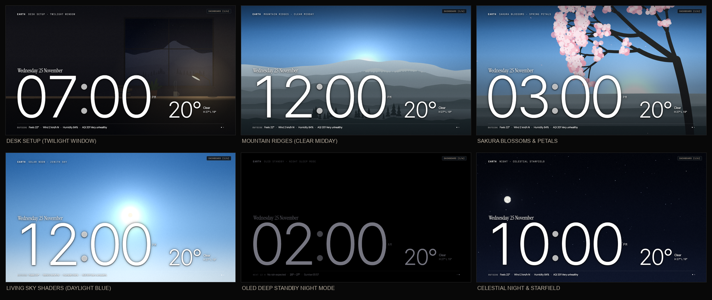
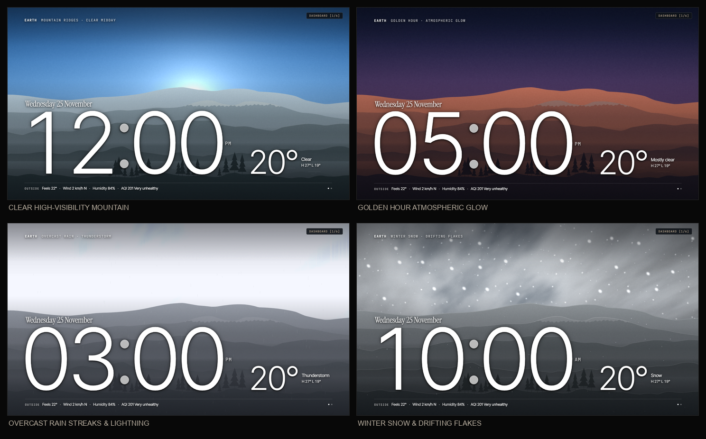
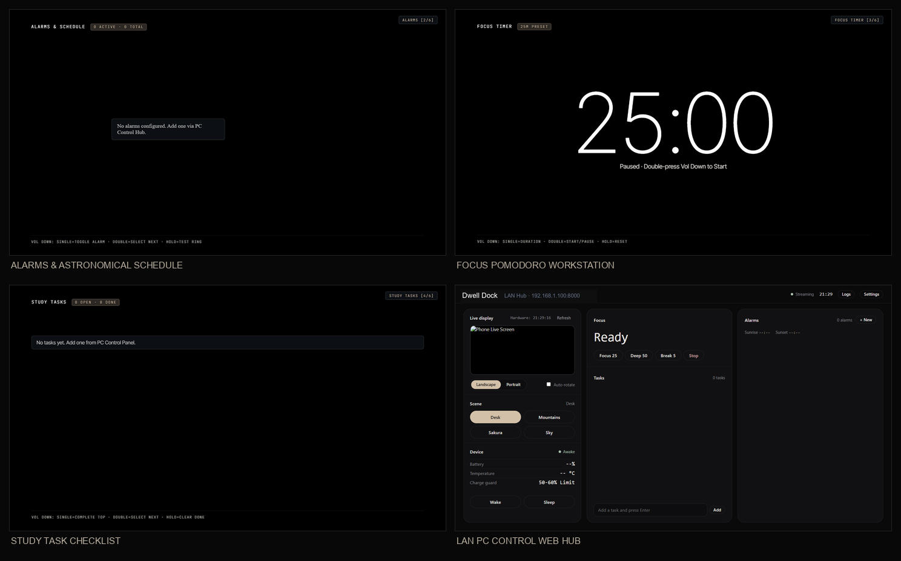

# Dwell — Universal Home Launcher

<div align="center">

<h1>Dwell</h1>
<p><strong>Display Well</strong></p>

[](https://github.com/str-VaibhavThakkar/dwell/actions)
[](LICENSE)
[](https://developer.android.com)
[](https://github.com/str-VaibhavThakkar/dwell/releases)
[-green)](#edition-overview-universal-daily-driver-home-launcher)
[](#zero-root-safe-mode)

</div>

---

> **Have an old phone with a broken screen, cracked glass, or dead touch digitizer?**  
> Check out the **[Headless Desk Dock Manual](README.headless.md)** (or switch to the [`master`](https://github.com/str-VaibhavThakkar/dwell/tree/master) branch) to learn how to convert it into a dedicated button-operated workstation!

---

## Edition Overview: Universal Daily Driver Home Launcher

**One phone. Full life. Still Dwell.**

You don't need a spare drawer phone or a rooted device to experience Dwell.

If you have only one primary daily-driver smartphone, **Dwell (Universal Edition)** replaces chaotic app grids with an elegant, distraction-free ambient home screen launcher and focus workstation — without overloading your phone, draining your battery, or locking you out of your everyday apps.

Whether sitting upright on a desk charging stand during deep work sessions or resting on your nightstand as an astronomical timepiece, Dwell delivers a calm, tactile experience that respects your attention.

---

## Visual Gallery

Dwell features dynamic Canvas 2D and WebGL procedural shaders that adapt to the real position of the sun, local weather, and celestial moon — all rendered on a pure AMOLED `#000000` canvas to eliminate night glare and backlight fatigue.

### 24-Hour Time Cycle: Dawn to OLED Night Mode
<div align="center">
  
  <p><em>Variation across natural hours (06:00 AM Dawn, 09:00 AM Morning, 12:00 PM Solar Noon, 05:00 PM Golden Hour Dusk, 10:00 PM Celestial Starfield, and 02:00 AM OLED Standby Sleep Mode).</em></p>
</div>

### Ambient Art Themes
<div align="center">
  
  <p><em>Hand-drawn Canvas 2D scenes layered over the sky engine: Desk Setup, Layered Mountains, Sakura Petals, Living Sky Shaders, OLED Deep Standby, and Celestial Starfield.</em></p>
</div>

### Procedural Weather Dynamics
<div align="center">
  
  <p><em>Real-time simulation of atmospheric conditions: high-visibility clear sky, golden hour, overcast rain streaks, and winter snowfall.</em></p>
</div>

### Workstation Suite and PC Control Hub
<div align="center">
  
  <p><em>Full productivity workstation: Astronomical Alarms, Pomodoro Focus Timer, Study Tasks, and Desktop PC LAN Web Hub.</em></p>
</div>

---

## Touch-First Experience and Gestures

Designed specifically for interactive touchscreen devices:

| Gesture / Touch Action | Target | Result |
| :--- | :--- | :--- |
| **Swipe Left / Right** | Entire Screen | Seamlessly transition between pages (Dashboard ↔ Alarms ↔ Focus ↔ Tasks ↔ Telemetry ↔ Mirror) |
| **Tap Alarm Card** | Alarms Page | Toggle alarm on/off with animated toggle slider |
| **Tap Checkbox** | Study Tasks | Mark tasks as completed with instant strikethrough |
| **Tap Preset Pills** | Focus Timer | Select 15m, 25m, 45m, or 60m Pomodoro blocks |
| **Tap Gear Icon** | Any Page | Open on-device Settings & Launcher Switcher |

---

## Seamless Home Launcher Coexistence

Dwell is a certified Android Home Launcher (`CATEGORY_HOME` / `CATEGORY_DEFAULT`). It is built to peacefully coexist with your daily phone's native launcher (Samsung One UI, Google Pixel Launcher, Xiaomi MIUI/HyperOS, OxygenOS):

- **Switch Launchers in 1 Tap**: Open Dwell's on-screen Settings page and tap **"Switch Launcher"** to immediately return to your system launcher or change defaults.
- **Access Your System Apps**: A single tap on **"Open System Settings"** or your app drawer shortcut gives you instant access to your regular apps whenever you need them.
- **No Lock-in**: Dwell never hijacks your device. If you swipe home, Dwell greets you with ambient calm; if you want to switch back to normal phone mode, it takes two seconds.

---

## Zero-Root Safe Mode

Unlike the headless `master` branch, the Universal build requires **zero root permissions**:
- **100% Public Android APIs**: Built strictly with standard `BatteryManager`, `PowerManager`, and `AlarmManager`.
- **Zero Kernel Hacks**: Operates cleanly within standard Android security sandboxes.
- **Zero Battery Drain**: Automatically suspends WebView WebGL rendering when the screen is turned off or when you switch to another app.
- **AMOLED Battery Conservation**: Pure `#000000` dark theme turns off OLED subpixels completely to save power.

---

## On-Device Settings Hub

Everything can be configured directly on your phone's screen without needing a computer:
- **Theme Selector**: Switch between Desk, Mountain Ridge, Sakura, Living Sky, OLED Night, and Celestial Starfield scenes.
- **Time Format**: Toggle 12-hour (AM/PM) and 24-hour military display.
- **Coordinates & City**: Set your location manually or allow auto-detection for astronomical sunrise/sunset calculations.
- **Display Timeout**: Choose when the screen sleeps (30s, 60s, 120s, or Never while charging).
- **Alarm Sounds**: Choose your preferred chime from local device tones.

---

## Installation Guide

### Step 1: Download the Universal APK
On your Android phone, download `dwell-universal-v1.0.0.apk` directly from [GitHub Releases](https://github.com/str-VaibhavThakkar/dwell/releases).

### Step 2: Install the App
1. Open the downloaded `.apk` in your phone's file manager and tap **Install**.
2. If prompted by Android, allow *Install unknown apps* for your browser or file manager.

### Step 3: First-Run Onboarding
When you launch Dwell for the first time:
1. **Set as Default Launcher (Optional)**: Choose Dwell when Android prompts for your preferred Home app, or select *Just Once* to test it out.
2. **Battery Optimization**: Tap to allow Dwell to run in the background so alarms ring with exact timing.
3. **Camera Permission (Optional)**: Grant camera access if you wish to use the built-in Mirror page.

### Alternative: Build from Source
```bash
git clone -b oss/universal https://github.com/str-VaibhavThakkar/dwell.git
cd dwell/android
./gradlew assembleDebug
```
The compiled APK will be generated at:
`app/build/outputs/apk/debug/app-debug.apk`

---

## Branch Comparison

| Feature | `oss/universal` (This Branch) | `master` (Headless Edition) |
| :--- | :---: | :---: |
| **Target Role** | Universal Daily Driver Launcher | Dedicated Headless Desk Dock |
| **Primary Controls** | Interactive Touchscreen & Swipes | Physical Hardware Volume Rockers |
| **Root Access** | Not Required (100% Unrooted) | Required (Magisk/KernelSU) |
| **Touchscreen Required?** | Yes (Smooth touch UI) | No (Works with broken glass) |
| **Battery Guard** | Safe Mode framework monitor | Direct sysfs 80%/60% cutoff |
| **Home Launcher Integration** | Dual-Launcher Coexistence | Hardened Dedicated Kiosk |
| **On-Device Settings GUI** | Full on-screen touch settings | Controlled via Web Hub / Buttons |

**Have an old phone with a broken screen that you want to turn into a dedicated desk clock?** Switch to the [`master`](https://github.com/str-VaibhavThakkar/dwell/tree/master) branch or read **[README.headless.md](README.headless.md)**.

---

## Contributing and Community

Dwell is shaped by real users. Having been users before builders, we believe open discussion, user criticism, and shared ideas are what build a great tool.

- Read our [Contributing Guidelines](CONTRIBUTING.md).
- View our [Code of Conduct](CODE_OF_CONDUCT.md).
- Report bugs via [GitHub Issues](https://github.com/str-VaibhavThakkar/dwell/issues).
- Discuss ideas in [GitHub Discussions](https://github.com/str-VaibhavThakkar/dwell/discussions).

---

## License

Dwell is open-source software licensed under the **Apache License, Version 2.0**.  
See the [LICENSE](LICENSE) file for complete details.

Copyright © 2026 **Vaibhav Thakkar** ([@str-VaibhavThakkar](https://github.com/str-VaibhavThakkar)).
